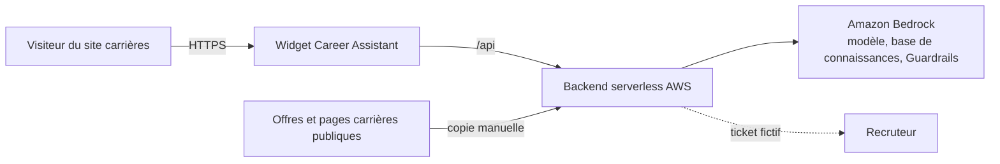
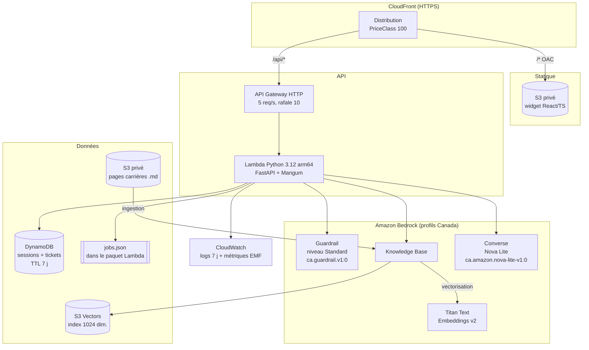
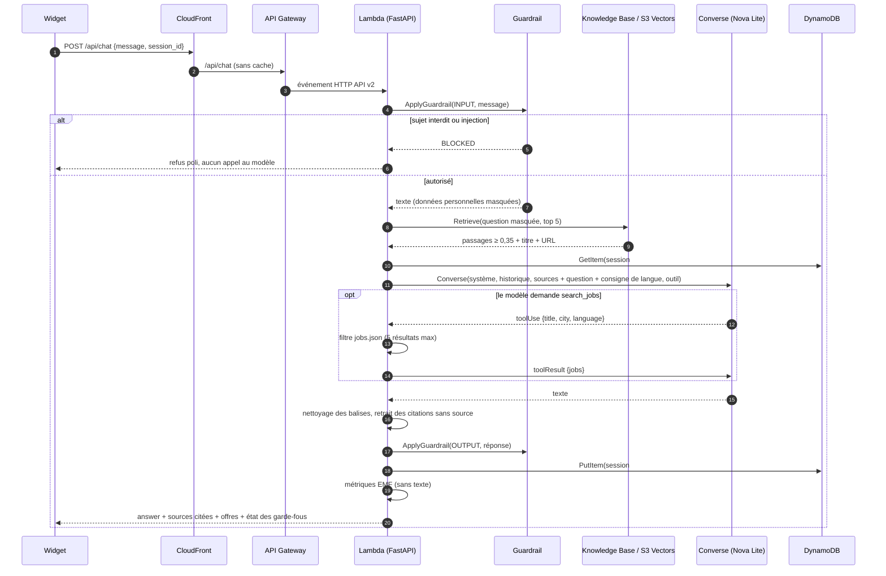
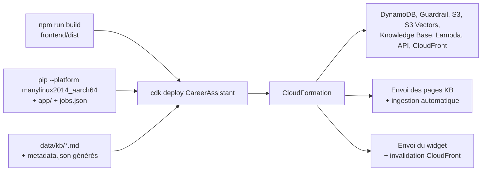

# Architecture — Career Assistant

> Prototype personnel, non affilié à l'entreprise dont le contenu carrières public sert d'exemple.
> Document de référence de l'architecture déployée (stack `CareerAssistant`, `ca-central-1`,
> 26 novembre 2026). Pour l'installation et les commandes, voir le [README](../README.md).

## Sommaire

1. [Contexte et objectifs](#1-contexte-et-objectifs)
2. [Vue d'ensemble](#2-vue-densemble)
3. [Composants](#3-composants)
4. [Parcours d'une requête](#4-parcours-dune-requête)
5. [Données](#5-données)
6. [Résidence des données](#6-résidence-des-données)
7. [Sécurité](#7-sécurité)
8. [IA responsable](#8-ia-responsable)
9. [Observabilité](#9-observabilité)
10. [Qualité : tests et évaluation](#10-qualité--tests-et-évaluation)
11. [Déploiement](#11-déploiement)
12. [Performance et coûts](#12-performance-et-coûts)
13. [Résilience et modes de défaillance](#13-résilience-et-modes-de-défaillance)
14. [Décisions d'architecture](#14-décisions-darchitecture)
15. [Limites et évolutions](#15-limites-et-évolutions)

---

## 1. Contexte et objectifs

Un site carrières reçoit beaucoup de questions répétitives (mode de travail, avantages, processus,
offres ouvertes), en français et en anglais. L'assistant y répond **à partir du contenu public
uniquement**, cite ses sources et oriente vers un humain quand il ne peut pas aider.

| Objectif | Traduction technique |
|---|---|
| Réponses fiables | RAG avec citations vérifiées côté serveur ; « je ne sais pas » hors corpus |
| Bilingue FR/EN | Détection de langue, consigne de langue par tour, embeddings et Guardrail multilingues |
| Aucune décision sur les candidats | Sujet bloqué par le Guardrail + interdiction dans le prompt |
| Protection des renseignements personnels | Masquage avant le modèle et avant le stockage, rétention 7 jours, pas de texte dans les logs |
| Données au Canada | Région `ca-central-1` + profils Bedrock « Canada uniquement » |
| Coût quasi nul au repos | 100 % serverless, aucun service facturé en continu |
| Changer de modèle sans code | API Converse ; modèle = paramètre de déploiement |

**Hors périmètre** : authentification des candidats, accès aux dossiers de candidature, intégration
ATS, dépôt de CV.

## 2. Vue d'ensemble

### 2.1 Contexte

### 2.2 Conteneurs

## 3. Composants

### 3.1 Widget (frontend)

| Élément | Détail |
|---|---|
| Pile | React 19, TypeScript, Vite ; ~71 ko gzip |
| Code | [ChatWidget.tsx](../frontend/src/components/ChatWidget.tsx), [AssistantMessage.tsx](../frontend/src/components/AssistantMessage.tsx), [api.ts](../frontend/src/api.ts), [i18n.ts](../frontend/src/i18n.ts) |
| Appels | `POST /api/chat`, `POST /api/escalations`, toujours sur la **même origine** (proxy Vite en local, CloudFront en AWS) : aucun CORS |
| État | Liste des messages en mémoire ; `session_id` dans `sessionStorage` (effacé à la fermeture de l'onglet) |
| Affichage | Mention « non affilié » et « je peux me tromper » permanentes ; sources numérotées ; cartes d'offres ; bandeau 🔒 quand des données ont été masquées ; bouton « Parler à un recruteur » ; interface FR/EN |
| Accessibilité | `role="dialog"`, `aria-live="polite"` sur le fil, libellés de champ, thème sombre automatique |
| Identité visuelle | Palette neutre volontaire : aucun élément de marque d'une entreprise réelle |

### 3.2 API (backend)

FastAPI exécuté par **Mangum** dans Lambda ; le même code tourne localement sous uvicorn.

| Route | Entrée | Sortie |
|---|---|---|
| `GET /health` | — | `{status, mode, disclaimer}` |
| `POST /chat` | `{message (1–2000 car.), session_id?}` | `{session_id, answer, sources[], jobs[], grounded, guardrail{input_masked, blocked}}` |
| `POST /escalations` | `{session_id, topic?}` | `201 {ticket_id, message}` |

Modules ([backend/app](../backend/app)) :

| Module | Responsabilité |
|---|---|
| `main.py` | Application FastAPI, injection des dépendances, handler Mangum (retire le préfixe `/api`) |
| `config.py` | Configuration `CA_*` (pydantic-settings) ; `mode=offline` ou `aws` |
| `assistant.py` | Orchestration d'un tour de conversation, boucle d'outil, nettoyage de la sortie, métriques |
| `retrieval.py` | `KnowledgeBaseRetriever` (Bedrock `Retrieve`) ; `LocalRetriever` (Markdown, hors ligne) |
| `guardrails.py` | `BedrockGuard` (`ApplyGuardrail`) ; `RegexGuard` (hors ligne) |
| `jobs.py` | Outil `search_jobs` : filtre titre/ville/langue, insensible aux accents, préfixe de mot |
| `store.py` | `DynamoStore` (sessions, tickets, TTL) ; `MemoryStore` (hors ligne) |
| `prompts.py` | Prompt système, construction du tour utilisateur, détection FR/EN |
| `metrics.py` | Émission de métriques CloudWatch au format EMF |
| `offline.py` | Faux client Converse pour développer sans AWS |

Chaque dépendance externe (modèle, récupération, Guardrail, stockage) est derrière une interface
(`Protocol`) avec une implémentation AWS et une implémentation locale : les tests n'appellent jamais
AWS.

### 3.3 Modèle de langage

| Paramètre | Valeur |
|---|---|
| API | Bedrock **Converse** (boto3), indépendante du fournisseur |
| Modèle par défaut | Amazon Nova Lite via `ca.amazon.nova-lite-v1:0` |
| Option qualité | Claude Haiku 5.5 via `ca.anthropic.claude-haiku-5-5` (`cdk deploy -c modelId=…`) |
| `maxTokens` | 1 024 |
| Outils | `search_jobs` uniquement ; au plus 3 tours d'outil par question |
| Client | délai de lecture 25 s, 3 tentatives en mode `adaptive` |

### 3.4 Base de connaissances

| Paramètre | Valeur |
|---|---|
| Source | Bucket S3 privé alimenté depuis `backend/data/kb/*.md` |
| Métadonnées | Un fichier `<page>.md.metadata.json` par page (`title`, `source_url`), généré par CDK depuis l'en-tête de la page |
| Découpage | Taille fixe : 300 jetons, chevauchement 15 % |
| Embeddings | Amazon Titan Text Embeddings v2, 1 024 dimensions (multilingue, sans abonnement Marketplace) |
| Stockage vectoriel | **S3 Vectors**, distance cosinus, `float32` ; texte et métadonnées Bedrock déclarés non filtrables |
| Requête | 5 passages, score minimal 0,35 |
| Mise à jour | Tâche d'ingestion lancée par CDK à chaque déploiement qui modifie le contenu (empreinte SHA-256 des pages) |

### 3.5 Guardrail

Appelé par `ApplyGuardrail`, **séparément** de l'appel au modèle.

| Politique | Configuration | Sens |
|---|---|---|
| Renseignements personnels | `EMAIL`, `PHONE`, `ADDRESS`, `CA_SOCIAL_INSURANCE_NUMBER`, `CA_HEALTH_NUMBER`, `CREDIT_DEBIT_CARD_NUMBER` → **anonymisés** (`{EMAIL}`…) | entrée et sortie |
| Sujets interdits | `CandidateEvaluation`, `PersonalInsuranceFile`, `Politics` → **bloqués** | entrée |
| Injection de prompt | `PROMPT_ATTACK`, force `HIGH` | entrée |
| Niveau | **Standard** (multilingue), profil `ca.guardrail.v1:0` | — |
| Version | `DRAFT` (démo) | — |

Deux pièges rencontrés : le niveau *Classic* ne comprend que l'anglais, et les actions d'entrée et
de sortie (`inputAction`, `outputAction`) doivent être déclarées explicitement, sinon aucune donnée
personnelle n'est détectée.

### 3.6 Stockage des conversations

Table DynamoDB à la demande, clé unique `pk` :

| `pk` | Attributs | Expiration |
|---|---|---|
| `session#<id>` | `messages` : 10 derniers messages, **après masquage**, sans les passages récupérés | `ttl` = +7 jours |
| `ticket#<id>` | `session_id`, `topic` (masqué), `status=open`, `created_at` | `ttl` = +7 jours |

## 4. Parcours d'une requête

Points clés :

- **Le texte brut de l'utilisateur ne quitte jamais l'étape 4** : récupération, modèle, stockage et
  journaux reçoivent la version masquée.
- **Une seule récupération par question**, toujours exécutée : le modèle ne décide pas s'il cherche,
  ce qui rend coût et latence prévisibles.
- **Les sources affichées sont recalculées par le serveur** à partir des numéros `[n]` présents dans
  la réponse ; une citation sans passage correspondant est supprimée du texte.
- **La consigne de langue et les phrases de repli** (« je ne sais pas », renvoi vers un recruteur)
  sont ajoutées à chaque tour : le petit modèle les respecte mieux là que dans le prompt système.

## 5. Données

| Donnée | Origine | Emplacement | Contient des renseignements personnels ? |
|---|---|---|---|
| Pages carrières | Texte public (offres Indeed) recopié à la main | `backend/data/kb/` → S3 → S3 Vectors | Non |
| Offres d'emploi (18) | Offres publiques via le connecteur Indeed | `backend/data/jobs.json`, embarqué dans la Lambda | Non |
| Historique de session | Visiteurs | DynamoDB, 7 jours | Masqués avant écriture |
| Tickets recruteur | Visiteurs | DynamoDB, 7 jours | Sujet masqué ; aucun contact collecté |
| Journaux | Lambda | CloudWatch, 7 jours | Non : compteurs et durées uniquement |

Aucune offre ni page n'est inventée ; le jeu de tests utilise des données explicitement
marquées « fictif ».

## 6. Résidence des données

| Traitement | Où il s'exécute |
|---|---|
| Stack, stockage, Lambda | `ca-central-1` |
| Inférence du modèle | Profil `ca.` : régions canadiennes uniquement |
| Évaluation du Guardrail | Profil `ca.guardrail.v1:0` : régions canadiennes uniquement |
| Embeddings | `ca-central-1` |
| CloudFront | Réseau mondial de points de présence ; ne met **pas** l'API en cache (`CACHING_DISABLED`) |

Les permissions IAM du modèle et du Guardrail utilisent `arn:aws:bedrock:*` pour la région, parce
qu'un profil Canada peut servir la requête depuis `ca-central-1` ou `ca-west-1`.

## 7. Sécurité

| Menace | Mesure |
|---|---|
| Abus et explosion des coûts | Limitation API Gateway 5 req/s (rafale 10) ; alertes AWS Budgets 20 $ / 50 $ |
| Injection de prompt | Filtre `PROMPT_ATTACK` du Guardrail ; outil unique, en lecture seule, sans effet de bord ; l'outil inconnu renvoie une erreur au modèle |
| Fuite de données personnelles | Masquage en entrée et en sortie ; aucun texte dans les journaux ; rétention 7 jours |
| Fuite du contenu de la sortie (balises, raisonnement) | Suppression de `<thinking>`, `<toolResult>` et de toute balise résiduelle |
| Accès direct aux buckets | S3 privés, `BLOCK_ALL`, SSL imposé ; widget servi uniquement via CloudFront OAC |
| Privilèges excessifs | Rôle Lambda limité à : 2 modèles, 1 base de connaissances, 1 Guardrail (+ profil), 1 table, lecture des abonnements Marketplace. Rôle de la base : lecture du bucket source, 1 modèle d'embeddings, 1 index vectoriel |
| Entrées malformées | Validation Pydantic (longueur, types) → `422` |
| Secrets | Aucun : authentification par rôles IAM uniquement |

Non couvert (démo) : authentification, WAF, domaine personnalisé, chiffrement par clé gérée (KMS
client).

## 8. IA responsable

- **Aucune décision automatisée** : demander d'évaluer, classer ou prédire l'embauche d'une personne
  est bloqué avant l'appel au modèle (`CandidateEvaluation`), et le prompt l'interdit.
- **Ancrage** : réponses limitées aux passages récupérés, citations vérifiées, phrase fixe « je ne
  sais pas » sinon.
- **Transparence** : prototype non affilié et faillibilité affichés en permanence ; sources visibles ;
  utilisateur informé du masquage.
- **Humain dans la boucle** : bouton « Parler à un recruteur » ; les questions sur son propre dossier
  sont renvoyées vers un humain.
- **Minimisation** (Loi 25) : rien n'est demandé, tout est masqué, tout expire en 7 jours.

## 9. Observabilité

Chaque requête émet une ligne JSON au format **EMF** (CloudWatch en extrait les métriques, sans appel
API supplémentaire), espace de noms `CareerAssistant` :

| Métrique | Usage |
|---|---|
| `latency_ms` | Latence de bout en bout côté Lambda |
| `input_tokens`, `output_tokens` | Suivi du coût du modèle |
| `grounded`, `no_answer` | Taux de réponses sourcées et de « je ne sais pas » (signal de corpus incomplet) |
| `pii_masked` | Fréquence des renseignements personnels saisis |
| `blocked` | Refus du Guardrail (abus, faux positifs à surveiller) |

Journaux Lambda conservés 7 jours. Un tableau de bord et des alarmes (latence p95, taux de
`no_answer`, erreurs 5xx) sont la prochaine étape.

## 10. Qualité : tests et évaluation

| Niveau | Outil | Couverture |
|---|---|---|
| Backend | pytest (27 tests) | Orchestration, citations, boucle d'outil, masquage avant modèle et stockage, refus, erreurs 503, langue, nettoyage de sortie, recherche d'offres |
| Widget | Vitest + Testing Library (7 tests) | Mentions permanentes, sources, session, cartes d'offres, erreurs, escalade, bascule FR/EN |
| Infrastructure | Jest + assertions CDK (7 tests) | TTL, limitation de débit, Guardrail (NAS, sujets, niveau Standard, profil Canada), S3 Vectors sans OpenSearch, journaux 7 j, buckets privés |
| Bout en bout | [run_eval.py](../backend/eval/run_eval.py), 21 questions FR/EN | Ancrage + mot-clé attendu, offres, « je ne sais pas », refus, masquage, renvoi vers un humain, langue, latence |

L'évaluation est **déterministe** (pas de LLM juge) et sert de test de non-régression avant tout
changement de prompt, de modèle ou de Guardrail. Dernier résultat : 21/21 (19 à 21 selon les
passages), langue 21/21, latence médiane 1,2 s.

## 11. Déploiement

- **IaC** : une seule stack CDK TypeScript, [career-assistant-stack.ts](../infra/lib/career-assistant-stack.ts).
- **Paquet Lambda** : construit **sans Docker** avec des wheels Linux arm64 (repli sur l'image
  officielle Python 3.12 si l'empaquetage local échoue).
- **Changement de modèle** : `cdk deploy -c modelId=ca.anthropic.claude-haiku-5-5`.
- **Durée** : environ 5 minutes la première fois, 20 à 40 secondes pour une mise à jour.
- **Suppression** : `cdk destroy` supprime tout (politique `DESTROY`, buckets vidés automatiquement).
- **Configuration de la Lambda** : `CA_MODE`, `CA_AWS_REGION`, `CA_MODEL_ID`, `CA_TABLE_NAME`,
  `CA_KNOWLEDGE_BASE_ID`, `CA_GUARDRAIL_ID`, `CA_GUARDRAIL_VERSION`.

## 12. Performance et coûts

**Latence mesurée** : médiane 1,2 s, maximum 4,5 s (premier appel après un démarrage à froid).
Lambda : 512 Mo, arm64, délai maximal 29 s (limite d'API Gateway).

**Coûts** (prix publics `ca-central-1`, 26 nov. 2026 ; 4 messages par conversation, ~2 500 jetons
en entrée et ~250 en sortie par message) :

| Poste | 1 000 conv./mois | 50 000 conv./mois |
|---|---|---|
| Nova Lite | 0,80 $ | 42 $ |
| Guardrails | ~2 $ | ~100 $ |
| Infrastructure | < 1 $ | ~10 $ |
| **Total** | **≈ 4 $** | **≈ 150 $** |

Aucun service n'est facturé au repos (pas d'OpenSearch Serverless, de NAT Gateway ni de Kendra).
Avec un petit modèle, **les Guardrails sont le premier poste de coût** : les sujets ne sont évalués
qu'en entrée pour cette raison. Les tarifs du niveau Standard des Guardrails et de S3 Vectors sont à
confirmer avant toute projection formelle.

## 13. Résilience et modes de défaillance

| Défaillance | Comportement |
|---|---|
| Limitation Bedrock, indisponibilité, délai dépassé, accès refusé | `503` « service momentanément indisponible » ; le widget affiche un message de réessai |
| Erreur de validation Bedrock (bogue) | Exception remontée (`500`) pour être visible dans les journaux |
| Plus de 3 tours d'outil | Arrêt de la boucle, message d'indisponibilité |
| Le modèle refuse ou filtre (`content_filtered`, `guardrail_intervened`) | Refus poli bilingue |
| Aucun passage pertinent | « Je ne sais pas d'après les informations publiques disponibles » |
| Dépassement du débit API Gateway | `429` renvoyé par API Gateway |
| Démarrage à froid | +3 s environ sur le premier appel ; préchauffage manuel avant une démo |

Tous les services sont régionaux et gérés (multi-AZ par défaut) ; aucune instance à maintenir.

## 14. Décisions d'architecture

| # | Décision | Alternatives écartées | Raison |
|---|---|---|---|
| 1 | **RAG avec récupération systématique** + boucle d'outil courte | Agent libre qui décide de chercher | Latence, coût et ancrage prévisibles ; le besoin ne justifie pas un agent ouvert |
| 2 | **API Converse** | SDK propre à un fournisseur | Nova et Claude avec le même code ; changement de modèle par configuration |
| 3 | **Nova Lite** par défaut | Claude Haiku 5.5 | Modèle le moins cher au Canada ; qualité suffisante une fois le prompt cadré ; Haiku prêt en option |
| 4 | **`ApplyGuardrail` séparé** | Guardrail intégré à l'appel Converse | Même politique pour tout modèle ; entrée bloquée avant toute dépense de modèle ; masquage aussi appliqué au stockage |
| 5 | **S3 Vectors** | OpenSearch Serverless, Aurora pgvector | Aucun minimum facturé ; suffisant pour un petit corpus |
| 6 | **Titan Text Embeddings v2** | Cohere Embed Multilingual | Cohere passe par AWS Marketplace (abonnement refusé au rôle de la base) ; Titan est multilingue, même prix, même dimension |
| 7 | **Lambda + FastAPI + Mangum** | ECS/Fargate, Lambda sans framework | Coût nul au repos ; même code en local et en ligne ; OpenAPI et validation Pydantic gratuites |
| 8 | **API Gateway HTTP** | API REST | Moins cher, plus simple ; la limitation de débit par étape suffit |
| 9 | **`/api` derrière CloudFront** | API sur un domaine séparé | Une seule origine, pas de CORS |
| 10 | **Offres dans un JSON embarqué** | Table, recherche vectorielle | 18 offres : un filtre en mémoire est instantané et déterministe |
| 11 | **Profils Canada** (modèle, Guardrail) | Profils `us.` ou `global.` | Résidence des données au Canada (Loi 25) |
| 12 | **Évaluation déterministe** | LLM juge | Gratuite, reproductible, explicable |

## 15. Limites et évolutions

**Limites actuelles**

- Corpus réduit (2 pages de synthèse, 18 offres) ; les pages du site carrières officiel manquent.
- Nova Lite n'est pas déterministe : 19 à 21/21 selon les passages.
- Guardrail en version `DRAFT`.
- Pas d'authentification, de WAF ni de domaine personnalisé.
- Détection de langue heuristique, FR/EN uniquement.
- Offres figées au moment du déploiement.

**Pour passer en production**

1. Offres synchronisées depuis l'ATS (tâche planifiée → S3 → réindexation).
2. Version de Guardrail figée à chaque déploiement, revue des blocages.
3. WAF, domaine personnalisé, SSO pour les recruteurs.
4. Routage de modèle mesuré sur le jeu d'évaluation : Nova pour les questions simples, Claude pour
   les cas complexes.
5. Retour 👍/👎, revue humaine d'échantillons, enrichissement continu du jeu d'évaluation.
6. Tableau de bord et alarmes CloudWatch ; pipeline CI/CD avec évaluation obligatoire avant
   déploiement.
